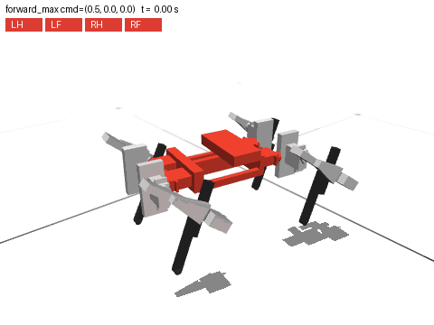

# Locomotion RL



This repository contains the simulation environment, training and evaluation code for a quadruped locomotion task with joystick command.

- The simulator used is [MuJoCo Playground](https://github.com/google-deepmind/mujoco_playground), with the MuJoCo Warp backend
- Training code and rewards were heavily inspired by the Unitree [go1 joystick scenario](https://github.com/google-deepmind/mujoco_playground/tree/main/mujoco_playground/_src/locomotion/go1) from Playground
- The robot definition is a simplified model of a real custom build. The build is incomplete as of this writing and has not been tested.

The following SCENARIO are defined in registry for different terrains:
- `CustomRobotJoystickFlatTerrain` : A flat plane
- `CustomRobotJoystickRoughTerrain` : A heightmap based FBM terrain
- `CustomRobotJoystickBlockTerrain` : A heightmap based blocky terrain

## Requirements
- Python 3.12.3
- A `venv` environment defined by `requirements.txt`
- CUDA 13+ capable GPU is highly recommended for running the simulation tasks

## Usage

```bash
python -u -m locomotion_rl.locomotion --num_timesteps {TIMESTEPS} --env_name {SCENARIO}
```
Trains a policy for `{TIMESTEPS}` on `{SCENARIO}`, saving it into `logs/{SCENARIO}-yyyyMMdd-HHmmss` e.g. `CustomRobotJoystickFlatTerrain-20261120-043000`.

```bash
python -u -m locomotion_rl.rollout --checkpoint {CHECKPOINT} --env_name {SCNEARIO} --gif
```
Rolls out a trained policy from folder `{CHECKPOINT}` (using the last saved checkpoint), recording metrics under `{CHECKPOINT}\{SCENARIO}_rollout.txt`. 
`--gif` creates short visulisations within `{CHECKPOINT}/gifs`.

<br>

Additional parameters and ``--help`` hints are available for these scripts (`locomotion_rl.locomotion` and `locomotion_rl.rollout`).

## AI Usage declaration
Claude Code was used for code generation and scripting. Attempts to use it otherwise were counterproductive.